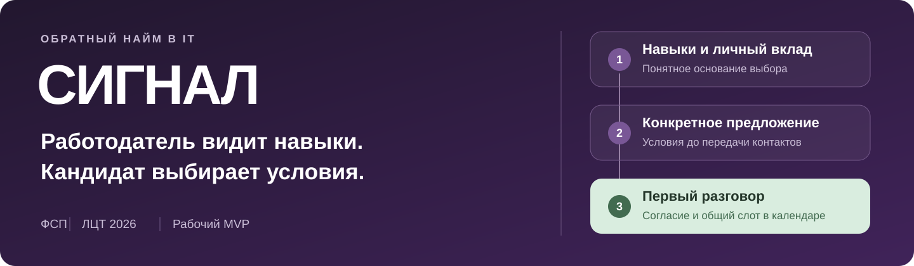
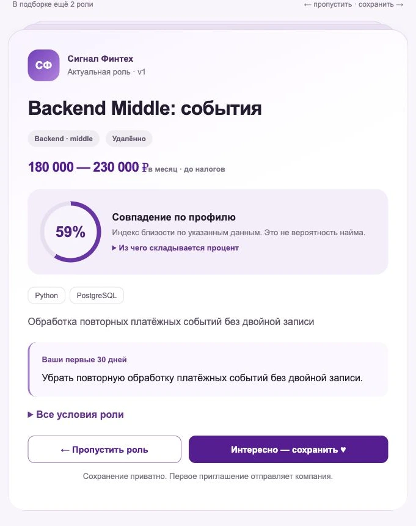
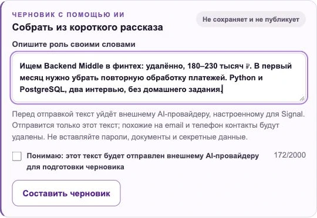
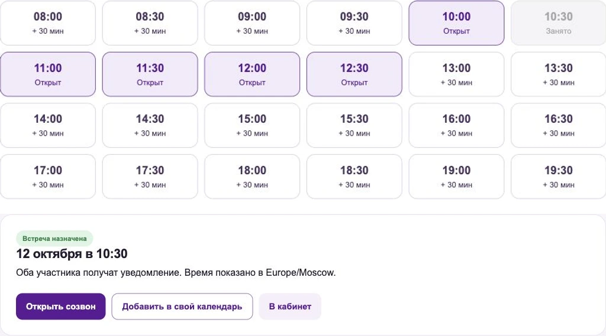

<p align="center">
  
</p>

<p align="center"><strong>Карточки ролей · проверка навыков · ИИ-помощник · первый разговор с HR</strong></p>

<p align="center">
  <a href="#возможности">Возможности</a> ·
  <a href="#как-это-работает">Сценарии</a> ·
  <a href="#бизнес-модель">Бизнес-модель</a> ·
  <a href="#быстрый-запуск">Запуск</a> ·
  <a href="#архитектура">Архитектура</a> ·
  <a href="#команда">Команда</a>
</p>

# ФСП Сигнал

**Работодатель видит навыки. Кандидат выбирает условия.**

Сигнал — платформа обратного найма в IT. Компания первой приглашает специалиста и объясняет, почему он подходит. Кандидат заранее видит зарплату, задачи и этапы отбора, сам открывает контакт и выбирает время в календаре HR.

Проект для специального трека ФСП на «Лидерах цифровой трансформации 2026». Мы соединяем достижения участника, практическую оценку и понятное предложение работодателя в один путь до первого разговора.

> **Рабочий MVP.** Основные сценарии реализованы. Демо использует синтетические данные, а качество найма и коммерческую модель предстоит проверить в пилоте. Реальный реестр ФСП, платежи и автоматическое распознавание аудио пока не подключены.

## Почему Сигнал

**Кандидату важно понять предложение до знакомства.** Поэтому в карточке есть зарплата, формат работы, первые 30 дней, длительность этапов, тестовое задание и срок ответа. Сохранённые роли приватны: это не массовая рассылка откликов.

**HR важно понимать, почему стоит позвать именно этого человека.** Поэтому подборка показывает причины совпадения и пробелы в данных. Практическую оценку, заявленные навыки и рассказ о личном вкладе мы показываем раздельно.

**После выбора нужен простой следующий шаг.** Приглашение закрепляет конкретную версию условий. После принятия кандидат выбирает свободный слот, а обе стороны получают встречу с календарём и ссылкой на созвон.

## Продукт вживую

<table>
  <tr>
    <td width="50%" valign="top">
      <p><strong>Кандидат: понятный выбор роли</strong></p>
      
      <p>Сохранить, пропустить, вернуть. Условия и объяснение уже в карточке.</p>
    </td>
    <td width="50%" valign="top">
      <p><strong>HR: от короткого рассказа до встречи</strong></p>
      
      <p>Помощник готовит черновик. Проверяет и публикует его работодатель.</p>
      
      <p>Слоты HR и подтверждение брони. Часовой пояс, ссылка на созвон и ICS.</p>
    </td>
  </tr>
</table>

<sub>Реальные экраны локального демо. Профили, компании и вакансии вымышлены. Процент в карточке — индекс совпадения доступных данных, а не вероятность найма.</sub>

## Возможности

| Что есть | Какую задачу решает |
|---|---|
| **Профиль из PDF или вручную** | Резюме с текстовым слоем превращается в редактируемый черновик. Отдельная история достижения раскрывает задачу, личный вклад, решение и результат. |
| **Практическая проверка навыков** | Две фазы со сменой условий задачи. Кандидат получает историю попыток и приватный разбор тем с упражнениями. |
| **Карточки ролей со свайпами** | Быстрый просмотр условий, сохранение, скрытие и возврат. Доступны также обычный список и объяснение процента. |
| **ИИ-помощник** | Помогает оформить предпочтения кандидата, историю достижения и вакансию HR. Любой черновик требует проверки и отдельного сохранения человеком. |
| **Объяснимый подбор** | Поиск внутри подтверждённой категории, фильтры предпочтений, причины совпадения и отдельный показатель полноты доказательств. |
| **Версии условий и приватность** | Приглашение сохраняет условия и основания. Контакты получает только пригласившая компания после согласия кандидата. Доступ можно отозвать. |
| **Календарь и рабочее место HR** | Слоты 20/30 минут, защита от двойной брони, отмена и ICS. Приватное избранное, сохранённые подборки и воронка по версии роли. |
| **Материалы встречи** | Общие заметки, текст беседы и ИИ-итоги. Для записи и расшифровки нужны согласия обоих участников. Созвон проходит по внешней ссылке. |
| **Продвижение вакансий** | Отдельная маркированная полка с теми же обязательными фильтрами. Продвижение не меняет органический рейтинг. Сейчас это демо без оплаты. |

## Как это работает

### Для кандидата

1. **Рассказать о себе.** Заполнить профиль или импортировать PDF, указать предпочтения и личный вклад в проекты. При желании использовать ИИ-черновик.
2. **Подтвердить навыки.** Выбрать доступную категорию, пройти практическую оценку и посмотреть разбор. Публикация профиля и согласия — отдельные действия.
3. **Выбрать подходящие условия.** Смотреть роли в списке или карточках, сохранять интересные и скрывать неподходящие.
4. **Принять конкретное приглашение.** Проверить компанию, зарплату, этапы и основания интереса HR. Затем открыть контакт этой компании и забронировать время.

### Для работодателя

1. **Описать реальную потребность.** Задача команды, первые 30 дней, бюджет, формат и этапы. Помощник ускоряет подготовку, но не публикует за HR.
2. **Получить обоснованную подборку.** Уточнить фильтры, посмотреть доказательства и сохранить кандидатов. История поиска остаётся доступной после перезагрузки.
3. **Пригласить с условиями.** Указать, что заинтересовало в кандидате, и отправить предложение на зафиксированной версии роли.
4. **Договориться о первом разговоре.** Открыть слоты, получить бронь и вести встречу в общей воронке. Состоявшееся интервью подтверждают оба участника.

## Бизнес-модель

Проверяем **B2B-модель**: работодатель платит за работу с подходящими специалистами. Базовый доступ кандидата, оценку навыков и контроль приватности предполагаем оставить бесплатными.

| Предложение | За что платит работодатель | Статус |
|---|---|---|
| **Подбор под одну роль** | Пилот с обоснованным shortlist и приглашениями по конкретной потребности | Гипотеза первого платного предложения |
| **Подписка HR** | Повторный найм: активные роли, сохранённые подборки, избранное, календарь и воронка | Модель для проверки после повторных покупок |
| **Продвижение роли** | Дополнительная видимость в отдельной маркированной полке | Демо-механика реализована, платежей нет |

Оплата не покупает высокий грейд, доказательство навыка или органический балл. В пилоте измеряем принятие приглашений, время HR до shortlist, подтверждённые встречи и готовность оплатить повторный найм. Действующих тарифов и подтверждённой выручки пока нет.

Продуктовые основания и анализ аналогов сохранены в [ресерче](docs/research/PRODUCT_RESEARCH.md).

## Быстрый запуск

Самый простой способ показать полный сценарий, включая регистрацию и письма, — **Docker Compose**. Нужен работающий Docker Engine с Compose v2.

```sh
git clone --branch main https://github.com/polluxik/fsp-signal.git
cd fsp-signal
docker compose up --build -d
docker compose exec api python -m backend.seed_demo
docker compose ps
```

Это первый запуск **собственного чистого демо**. `seed_demo` добавляет учебные профили и роли и сам импортирует каталог. Не запускайте его на данных реальных пользователей.

| Что открыть | Адрес по умолчанию |
|---|---|
| Платформа | [127.0.0.1:8080](http://127.0.0.1:8080/) |
| Письма регистрации и приглашений в Mailpit | [127.0.0.1:8025](http://127.0.0.1:8025/) |
| Swagger UI | [127.0.0.1:8080/api/docs](http://127.0.0.1:8080/api/docs) |
| OpenAPI | [127.0.0.1:8080/api/openapi.json](http://127.0.0.1:8080/api/openapi.json) |
| Готовность API | [127.0.0.1:8080/api/v1/health/ready](http://127.0.0.1:8080/api/v1/health/ready) |

**Если 8080 занят:** задайте `FSP_WEB_PORT=58080` в `.env` в корне перед запуском Compose. Сайт, Swagger и ссылки из писем будут использовать этот порт. Mailpit останется на 8025.

### Демо-доступ

| Роль | Email | Пароль |
|---|---|---|
| Работодатель | `employer@demo.test` | `DemoPass123!` |
| Другая компания для проверки приватности | `other@demo.test` | `DemoPass123!` |
| Кандидат Backend Middle | `backend-middle-1@demo.test` | `DemoPass123!` |

Это публичные **учебные аккаунты**, не production-доступ. Для прохождения оценки с нуля зарегистрируйте нового кандидата и подтвердите email по письму в Mailpit.

<details>
<summary><strong>Короткий сценарий демонстрации для жюри</strong></summary>

1. Работодатель: **«Роль и условия»**, затем **«Найти специалиста»**. Открыть подборку и показать причины совпадения.
2. Отправить приглашение с зарплатой и выбранными основаниями. Проверить его версию условий.
3. Кандидат: **«Для меня» → «Карточки»**. Сохранить роль, скрыть другую и вернуть её. Сохранение не раскрывает контакт.
4. В приглашениях принять предложение. Первая компания получает контакт, вторая не получает.
5. Работодатель: **«Календарь HR»**. Открыть будущие слоты. Кандидат выбирает свободное время по ссылке после принятия приглашения.
6. Показать ICS, назначенную встречу и воронку. Назначенная встреча ещё не считается состоявшимся интервью.

Для проверки регистрации используйте полный Compose. Для ИИ-демо предварительно настройте серверный ключ по разделу ниже.

</details>

<details>
<summary><strong>Настройка ИИ-помощника и аудио</strong></summary>

Создайте локальную `.env` по [.env.example](.env.example), если её ещё нет, и добавьте свой ключ. Существующую `.env` не перезаписывайте.

```dotenv
FRONTIERAI_BASE_URL=https://gateway.frontierai.ru/v1/chat/completions
FRONTIERAI_MODEL=qwen3.8-27b-4a100
FRONTIERAI_API_KEY=your_server_side_key
AI_ASSISTANT_TIMEOUT_SECONDS=30
```

Применить настройки контейнера API:

```sh
docker compose up -d api
```

Compose передаёт ключ только серверу. Не добавляйте его в Git, frontend, `VITE_*`, изображения или логи. При прямом запуске Python `.env` автоматически **не читается**: переменные нужно экспортировать в окружение сервера.

Без ключа профиль, оценка, подбор, приглашения и календарь работают без внешней модели. ИИ-функции недоступны. Перед отправкой текста помощнику пользователь даёт отдельное согласие, а похожие на email и телефон фрагменты маскируются. Ответ проходит проверку схемы и не применяется автоматически.

ASR настраивается **отдельно** через `TRANSCRIPTION_API_URL`, `TRANSCRIPTION_API_KEY` и `TRANSCRIPTION_MODEL`. Ключ chat API не включает распознавание аудио. Браузер пишет только собственный микрофон, а не всю конференцию. Полные условия и ограничения — в [архитектуре встреч](docs/CALENDAR_MATCH_ARCHITECTURE.md).

</details>

<details>
<summary><strong>Разработка без контейнеров: Linux/macOS и Windows</strong></summary>

Нужны **Python 3.12** и **Node.js 22.12+**. Команды выполняются из корня репозитория. SQLite удобен для собственной dev-базы, но не заменяет PostgreSQL-проверки гонок.

Linux/macOS, терминал API:

```sh
python3.12 -m venv .venv
. .venv/bin/activate
python -m pip install -r backend/requirements.txt
export APP_MODE=demo
export DATABASE_URL=sqlite:///./fsp_signal_demo.db
export PUBLIC_BASE_URL=http://127.0.0.1:5173
python -m alembic upgrade head
python -m backend.seed_demo
python -m uvicorn backend.main:app --host 127.0.0.1 --port 8000
```

Windows PowerShell, терминал API:

```powershell
py -3.12 -m venv .venv
& '.venv/Scripts/python.exe' -m pip install -r backend/requirements.txt
$env:APP_MODE='demo'
$env:DATABASE_URL='sqlite:///./fsp_signal_demo.db'
$env:PUBLIC_BASE_URL='http://127.0.0.1:5173'
& '.venv/Scripts/python.exe' -m alembic upgrade head
& '.venv/Scripts/python.exe' -m backend.seed_demo
& '.venv/Scripts/python.exe' -m uvicorn backend.main:app --host 127.0.0.1 --port 8000
```

Второй терминал, frontend:

```sh
cd frontend
npm ci
npm run dev
```

Откройте [127.0.0.1:5173](http://127.0.0.1:5173/). В демо-аккаунты можно войти без SMTP. Новая регистрация требует почтового сервера и отдельно запущенного `python -m backend.mail_worker` с тем же окружением БД.

**Важно:** SMTP Mailpit в `compose.yaml` доступен только внутри Docker-сети. Для Python на хосте нужен отдельно доступный SMTP на `localhost:1025` либо собственные `SMTP_HOST`/`SMTP_PORT`. Для полного email-сценария проще использовать Compose целиком.

</details>

> **Публичный запуск требует отдельной конфигурации.** Compose в репозитории намеренно привязан к localhost и использует демо-пароли, `APP_MODE=demo`, mock ФСП и незащищённую HTTP-cookie. Это не production-конфигурация. Нужны HTTPS, secure cookie, свои секреты, SMTP и политика хранения данных; одной смены `.env` для параметров, зафиксированных в Compose, недостаточно.

## Архитектура

**React 19 / TypeScript / Vite** на клиенте. **FastAPI / SQLAlchemy / Alembic** на сервере. **PostgreSQL 17** в Compose, SQLite для локальной разработки. Основной сценарий не требует GPU или внешнего LLM.

| Контур | Где смотреть | Что делает |
|---|---|---|
| Интерфейс | [frontend/src/features](frontend/src/features/) | Два кабинета, роли, карточки, предпочтения, календарь и рынок |
| HTTP API | [backend/main.py](backend/main.py), [routes_v2.py](backend/routes_v2.py) | Авторизация, доступ и продуктовые маршруты |
| Оценка и подбор | [assessment.py](backend/assessment.py), [matching.py](backend/matching.py) | Практическая рубрика, категории, фильтры и объяснения |
| Условия и согласия | [role_cards.py](backend/role_cards.py), [invitations.py](backend/invitations.py), [preferences.py](backend/preferences.py) | Неизменяемые версии условий, основания приглашений, доступ к контактам |
| Встречи и воронка | [scheduling.py](backend/scheduling.py), [employer_pipeline.py](backend/employer_pipeline.py) | Бронь, конфликтующие интервалы, избранное и подтверждение интервью |
| ИИ и письма | [ai_assistant.py](backend/ai_assistant.py), [meeting_ai.py](backend/meeting_ai.py), [mail_worker.py](backend/mail_worker.py) | Серверный gateway, проверка ответов и SMTP-очередь в БД |
| Данные и инфраструктура | [models.py](backend/models.py), [migrations](backend/migrations/), [infra](infra/), [compose.yaml](compose.yaml) | Хранение, миграции, API/worker, Caddy, PostgreSQL и Mailpit |

<details>
<summary><strong>Как считается совпадение и почему это не вероятность найма</strong></summary>

В поиске работодателя `match_v2` сначала проверяет категорию, доступность, согласия и известные несовместимые обязательные условия. Затем рассчитывает балл внутри точной специализации и грейда.

| Сигнал | Базовый вес |
|---|---:|
| Подтверждённые компетенции выбранной роли | 60% |
| Результат профильной оценки | 35% |
| Лексическое совпадение оценённых компетенций | 5% |

Если компонент неизвестен, веса доступных компонентов нормализуются. Полнота доказательств отображается отдельно: высокий балл при неполных данных не означает полную уверенность. Достижение ФСП даёт не более +5 внутри уже подтверждённой категории, не заменяет тест и не штрафует кандидата своим отсутствием.

Кандидатская лента использует **другой** индекс — `discovery_match_v1`: описание, заявленный/желаемый стек, компетенции и агрегированный интерес похожих кандидатов. Лента упорядочена по актуальности. Её процент не нужно путать с работодателевым ранжированием или вероятностью найма.

Подробности: [контур карточек и встреч](docs/CALENDAR_MATCH_ARCHITECTURE.md), [спецификация](docs/PRODUCT_SPEC.md), [протокол валидации](docs/validation/v2-protocol.md).

</details>

## Данные и границы MVP

В проекте есть **два разных набора демо-данных**:

| Набор | Объём | Как использовать |
|---|---|---|
| Учебный банк основного сценария | 96 синтетических assessment-профилей, 8 категорий | Показывать подбор, приглашения и приватность. Баллы seed — фикстуры, не результаты тестирования реальных людей. |
| Отдельный каталог «Рынок» | 200 резюме, 120 вакансий, 32 семьи IT-ролей | Читать полные документы, фильтровать и сравнивать заявленные условия. Все профили `not_assessed`, без реальных контактов. |

Реальная процедура оценки доступна для **Backend, Frontend, QA и Data Analyst**, каждый на **Junior и Middle**. Senior/Lead и другие профессии в каталоге — заявленные уровни вымышленных примеров, а не новые проверяемые категории.

На существующей демо-БД для импорта каталога достаточно:

```sh
docker compose exec api python -m backend.seed_market
```

Повторный импорт не создаёт дублей и не переписывает прежний корпус. [Данные и генератор](data/synthetic_market_v1/README.md) · [Контракт импорта](docs/SYNTHETIC_MARKET_INTEGRATION.md).

Границы, которые важны для честной демонстрации:

- PDF-импорт работает с текстовым слоем, до 5 МБ и 10 страниц. OCR сканов нет, исходный PDF не сохраняется.
- Mock ФСП не является интеграцией с реестром. Произвольный ID не подтверждает достижение.
- Автотесты и синтетическая симуляция проверяют механику. Точность на реальных людях, Precision@5/nDCG@5 с независимой разметкой и влияние на найм пока не доказаны.
- Отзыв доступа закрывает контакт в платформе, но не удаляет уже скопированные получателем сведения.
- Платежи, полноценная ATS-интеграция и подключённый ASR остаются следующими этапами.

## Проверки

В активированном Python-окружении из корня:

```sh
python -m pytest -q
```

Frontend и браузерные сценарии:

```sh
cd frontend
npm ci
npm run build
npm run test:e2e
```

Playwright использует установленный **Google Chrome** и Python из корневой `.venv`. Он поднимает отдельные API/Vite на временных портах, мигрирует временную SQLite и удаляет её после прогона. Для другого Python задайте `FSP_SIGNAL_E2E_PYTHON`. Live-ИИ проверки включаются отдельно через `FSP_SIGNAL_LIVE_AI=1` с серверными credentials; обычный прогон их пропускает.

PostgreSQL-проверки конкурентных операций требуют **выделенной тестовой БД** с именем, заканчивающимся на `_test`, и `TEST_DATABASE_URL`. Не указывайте рабочую БД. SQLite не доказывает корректность PostgreSQL row locks.

<details>
<summary><strong>Сохранённые результаты и воспроизводимость</strong></summary>

| Прогон | Результат | Источник |
|---|---|---|
| Интеграция рынка, 08.10.2026 | PostgreSQL: 216 passed. SQLite: 203 passed / 13 PG-only skipped. E2E: 29 passed, включая 3 live-Qwen. Production build успешен. | [Отчёт интеграции](docs/validation/synthetic-market-integration-results.md) |
| Карточки и ИИ-подбор, 09.10.2026 | E2E: 29 passed / 3 opt-in live-AI skipped. Production build, адаптивность и жесты проверены. PostgreSQL и live Qwen в этой итерации не проверялись. | [Отчёт UI-итерации](docs/TWIN_AI_2026-10-09.md) |

Это сохранённые результаты конкретных итераций, **не текущий статус CI** и не метрики качества найма.

Воспроизвести симуляцию механики assessment из корня:

```sh
python scripts/simulate_assessment_validation.py
```

Отчёт намеренно отделён от человеческой калибровки. Для качества matching есть [offline-расчёт метрик](scripts/evaluate_matching.py) и [формат разметки](data/evaluation/README.md), но шаблоны данных не являются достигнутыми результатами.

</details>

## Следующий этап

Пилот на одной роли с 3–5 работодателями и добровольными совершеннолетними кандидатами. Проверяем качество shortlist, понятность объяснений и путь до состоявшегося разговора. Затем калибруем задания и matching, проверяем повторный платный найм и подключаем реальные интеграции.

## Документация

- [Спецификация продукта](docs/PRODUCT_SPEC.md) — требования и полный дизайн.
- [Фактический статус](docs/implementation-status.md) — реализованное, частичное и запланированное.
- [Продуктовый ресерч](docs/research/PRODUCT_RESEARCH.md) — пользовательские потребности, аналоги и коммерческие гипотезы.
- [Воронка и избранное HR](docs/EMPLOYER_PIPELINE.md) — версии роли, приватность и конкурентные правки.
- [Календарь, matching и материалы встреч](docs/CALENDAR_MATCH_ARCHITECTURE.md) — контракты и ограничения.
- [Протокол оценки качества](docs/validation/v2-protocol.md) — качество matching и границы assessment-симуляции.
- [Аудит требований хакатона](docs/hackathon-requirements-audit.md) — ТЗ и ответы организаторов.
- [Экспорт OpenAPI](docs/openapi.json) — сохранённый API-контракт.

## Команда

| Участник | Направление | Telegram |
|---|---|---|
| **Бубушян Даниэль** | Frontend / UI | [@mr_bigeggs](https://t.me/mr_bigeggs) |
| **Багдасарян Аркадий** | Data Science | [@markinllz](https://t.me/markinllz) |
| **Крюков Всеволод** | Backend | [@Kry4ovVs](https://t.me/Kry4ovVs) |

<p align="center"><strong>Сигнал. Чтобы первый разговор начинался с понимания.</strong></p>
