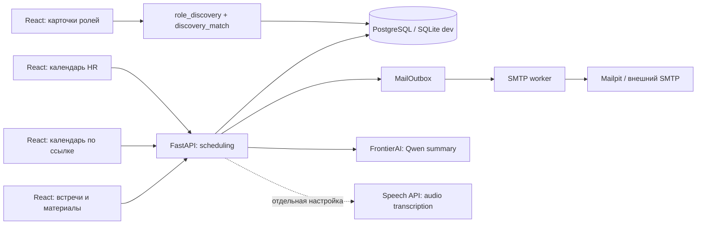

# Календарь HR, материалы встречи и карточки совпадения

Актуально на 7 октября 2026. Продолжать существующий проект; команда — 3 человека, срок — 5 дней. В `main` перенесена ветка `codex/signal-product-polish`, включая commit `82dab98`: новые сценарии работодателя/кандидата, ограниченный AI-помощник, продвижение ролей, двустороннее подтверждение интервью и дополнительные синтетические профили. Затем добавлены функции ниже.

## Что можно показать

1. HR открывает «Календарь HR», задаёт часовой пояс и HTTPS-ссылку на звонок. Выбирает день, диапазон 10:00–16:00 и длительность 20/30 минут. Диапазон разбивается на реальные слоты; отдельный слот можно включить/убрать нажатием на сетку. Забронированный слот удалить нельзя.
2. HR копирует персональную ссылку `/calendar/{token}`. По ней любой посетитель видит компанию и свободное время на неделе, но не участников, контакты или ссылку на звонок. Кандидат входит, принимает приглашение этой компании и бронирует слот. Уже принятые приглашения содержат ссылку на календарь.
3. Встреча появляется у обоих участников, ссылка на звонок закрепляется в момент бронирования. Есть экспорт `.ics`, общие заметки, отмена с освобождением слота и уведомления через существующую SMTP-очередь. Подтверждение факта интервью остаётся отдельным двусторонним действием: истечение времени не доказывает, что звонок состоялся.
4. Оба участника отдельно разрешают хранение записи/расшифровки. После начала слота можно загрузить аудио или записать собственный микрофон в браузере. После окончания — сохранить текст беседы и получить AI-черновик итогов: краткое содержание, решения, следующие шаги, открытые вопросы.
5. Кандидат переключает ленту «Список / Карточки». В карточках есть процент совпадения с объяснением, свайп/стрелки клавиатуры, «интересно» (приватное сохранение), пропуск и возврат скрытой роли. Основной сценарий обратного найма сохраняется: компания первой направляет приглашение.

## Сервисы и поток данных



Нового обязательного сервиса нет. React/Vite, FastAPI, SQLAlchemy/Alembic, PostgreSQL, Caddy, worker и Mailpit уже входят в Compose. Qwen — внешний chat completion. ASR — отдельный необязательный адаптер. Redis, брокер задач и векторная БД для этого MVP не требуются.

## Код и API

| Зона | Файлы | API под `/api/v1` |
|---|---|---|
| Календарь и брони | `backend/scheduling.py`, `backend/models.py` | `GET/PUT /employer/calendar`, `POST /employer/calendar/availability`, `DELETE /employer/calendar/slots/{id}` |
| Публичная ссылка | `frontend/src/features/calendar/PublicCalendar.tsx` | `GET /calendars/{token}`, `POST /calendars/{token}/book`, `GET /invitations/{id}/calendar` |
| Материалы | `MeetingList.tsx`, `backend/scheduling.py` | `GET /meetings`, `GET /meetings/capabilities`, `POST /meetings/{id}/cancel`, `PUT /meetings/{id}/materials`, `PUT /meetings/{id}/recording-consent` |
| Аудио/AI/ICS | `backend/meeting_ai.py` | `POST/GET /meetings/{id}/recording`, `POST /meetings/{id}/transcribe`, `POST /meetings/{id}/summary`, `GET /meetings/{id}/calendar.ics` |
| Совпадение и карточки | `backend/discovery_match.py`, `role_discovery.py`, `frontend/src/features/roles/MatchDetails.tsx`, `TwinDeck.tsx` | `discovery_match` в существующей ленте; `GET/PUT /candidate/recommendations/consent` |

OpenAPI: `/api/docs`. Миграция `a40e8c9f621b` после `81c4a62e7f09`: `InterviewCalendar`, `AvailabilitySlot`, `InterviewMeeting`, флаг участия в рекомендациях и новые intents учёта AI-запросов. Перед запуском обязательна `alembic upgrade head`; runtime не создаёт таблицы автоматически.

## Инварианты календаря и материалов

- Время хранится в UTC; API требует offset. UI переводит выбранное локальное время через IANA timezone. Часовой пояс HR и часовой пояс кандидата указаны явно.
- Диапазон: старт минимум через 5 минут, конец в пределах 90 дней, максимум 12 часов, делится без остатка на 20/30 минут. Пересечения доступности запрещены.
- Бронь требует verified candidate, accepted invitation той же компании, активный contact grant и отсутствие блокировки. Публичный token не заменяет авторизацию.
- На PostgreSQL: блокировки candidate → employer → slot, плюс частичный unique index одной активной брони слота. Кандидат не может назначить пересекающиеся звонки с разными компаниями; у приглашения одна активная встреча.
- Все изменения материалов используют `expected_version`. При параллельной правке возвращается 409, прежние данные не затираются. После внешнего AI-запроса версия и права проверяются повторно.
- Материалы доступны участникам. Отзыв contact grant/блокировка закрывает работодателю заметки, аудио, текст и итоги. Отзыв любого recording consent удаляет аудио, расшифровку и AI-итоги; общие заметки остаются.
- Аудио: WebM/Ogg/WAV/MP3/MP4, проверка MIME и сигнатуры, максимум 15 МБ. Микрофон браузера ограничен 5 минутами и записывает только локальную сторону. Полную запись созвона необходимо загрузить из сервиса видеосвязи.
- Текст/заметки — до 12 000 символов. Изменение записи/расшифровки сбрасывает прошлое резюме. Для внешней обработки требуется отдельное явное разрешение инициатора запроса. Общая квота AI — 10 запросов/час на пользователя, включая существующего помощника.
- AI не решает, нанимать ли человека. Ответ проходит ограниченную JSON-схему; контакты маскируются, инструкции внутри беседы считаются недоверенными данными. Ошибки провайдера не возвращают его секреты/тело ответа.

## Как считается процент

`discovery_match_v1` — объяснимый индекс сходства, не вероятность найма и не измеренная релевантность. Он показывается только кандидату и не меняет органическое ранжирование работодателя.

| Компонент | Базовый вес | Источник |
|---|---:|---|
| Описание и задачи | 45% | Cosine по словам описания/навыков/желаемых задач кандидата и title/description/first_30_days/stack роли |
| Заявленный и желаемый стек | 25% | Доля стека роли, совпавшая с указанным кандидатом |
| Компетенции | 20% | Существующая рубрика `match_v2`, только при совпадении проверенной категории; synthetic помечается |
| Интерес похожих кандидатов | 10% | Сходство с агрегированным описанием минимум пяти других кандидатов, сохранивших эту же версию роли |

Неизвестные компоненты исключаются, веса доступных нормируются. Нет данных → нет процента. Ко-лайки не являются доказательством навыков.

Для peer-сигнала используются только опубликованные, доступные, совершеннолетние профили с processing consent и отдельным `recommendation_consent`, свежей версией предпочтений и без блокировки компании. Реальные и синтетические профили не смешиваются. Расчёт локальный: нормированный centroid описаний и навыков; чужие тексты в LLM не уходят. Наружу выводится только размер группы, сходство и общие заявленные навыки, встречающиеся минимум у трёх участников. Нет имён, контактов, резюме или списков лайков. У реальных профилей участие по умолчанию выключено; фикстуры отдельно помечены.

Это рабочий baseline. Семантические embeddings/LLM-summary можно добавить после человеческой оценки и отдельной политики передачи данных; не заменять формулу случайным процентом и не выдавать synthetic метрики за пользовательские.

## LLM и что требуется второму участнику

Qwen подключается сервером через `FRONTIERAI_API_KEY`, `FRONTIERAI_MODEL=qwen3.8-27b-4a100`, `FRONTIERAI_BASE_URL=https://gateway.frontierai.ru/v1/chat/completions`. Ключ хранится только в локальной игнорируемой `.env`; `.dockerignore` исключает его из образа. Compose передаёт ключ API, frontend и worker его не получают. Проверен реальный структурированный ответ по синтетической беседе.

**Автоматическое распознавание аудио пока не подключено к реальному speech-провайдеру.** Chat completion не означает поддержку ASR. Реализованный multipart-адаптер ожидает три независимые переменные:

```dotenv
TRANSCRIPTION_API_URL=https://YOUR-SPEECH-SERVICE/v1/audio/transcriptions
TRANSCRIPTION_API_KEY=
TRANSCRIPTION_MODEL=
```

Это шаблон, не подтверждённый endpoint FrontierAI. Поставщик должен принимать `file`, `model`, `language=ru`, `response_format=json` и возвращать `{ "text": "..." }`. Без всех переменных кнопка недоступна, UI предлагает вставить текст вручную. Не использовать chat endpoint для загрузки аудио вслепую.

Задачи продолжения, по приоритету:

1. Подтвердить speech endpoint/модель, подключить реальные креды, проверить русское аудио с двумя голосами и шумом, ошибки/таймауты/отзыв согласия. Для больших файлов вынести обработку из HTTP в очередь с polling.
2. Выбрать сервис звонков; пока HR вставляет внешнюю HTTPS-ссылку. Автосоздание комнат, bot-recording и diarization не реализованы. Решить consent обеих сторон на внешнюю обработку до автоматической отправки полной записи.
3. Вынести аудио из DB blob в приватное object storage, добавить сроки хранения/очистку/экспорт/удаление. Сейчас blob допустим для короткого локального демо.
4. Протестировать рекомендации на людях, сравнить lexical baseline и embeddings, измерить полезность объяснений. Не менять приватность сохранений.
5. Подготовить публичный HTTPS-стенд, демонстрацию и финальный пакет документации/презентацию.

## Запуск и демо

```powershell
docker compose -p fsp-signal-smoke-20261007 up --build -d
docker compose -p fsp-signal-smoke-20261007 exec api python -m backend.seed_demo
```

В локальной `.env` установлен `FSP_WEB_PORT=58080`: сайт `http://127.0.0.1:58080`, почта `http://127.0.0.1:8025`. Для другой машины использовать `.env.example` и собственные секреты. `python-dotenv` не загружается автоматически прямым запуском uvicorn: при запуске без Compose экспортировать переменные окружения явно.

Аккаунты: `employer@demo.test`, `backend-middle-4@demo.test`, пароль `DemoPass123!`. Есть 96 синтетических профилей восьми категорий, дополнительные браузерные фикстуры и шесть сохранений backend middle роли для демонстрации порога ко-лайков. Не редактировать реальный профиль, чтобы подделать факт прошедшей встречи: для показа AI использовать отдельную synthetic fixture с прошедшим временем либо настоящую завершённую беседу.

## Проверки

```powershell
python -m pytest -q
cd frontend
npm run build
npm run test:e2e
```

Для гонок: выделенная PostgreSQL с именем БД, заканчивающимся `_test`, переменная `TEST_DATABASE_URL`. SQLite не доказывает корректность row locks. На Windows Playwright может попасть в зарезервированный порт; доступны `FSP_SIGNAL_E2E_API_PORT` и `FSP_SIGNAL_E2E_WEB_PORT` (например, 33065 и 49321), плюс `FSP_SIGNAL_E2E_PYTHON` для внешнего venv.

Новые тесты: `tests/test_calendar.py`, `tests/test_discovery_match.py`, `frontend/tests/calendar-match.spec.ts`. Проверяют диапазоны 20/30 минут, timezone, privacy, доступ только по принятому приглашению, дубли брони, отмену, ICS, материалы/версии/согласия, Qwen-контракт, threshold ко-лайков, stale preferences, swipe/save/hide/undo и мобильный экран. Итоговые результаты — в [статусе реализации](implementation-status.md).
