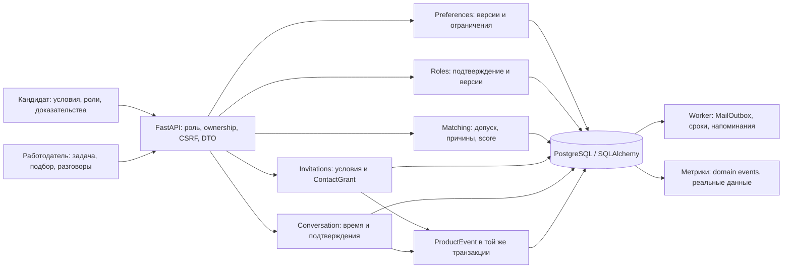
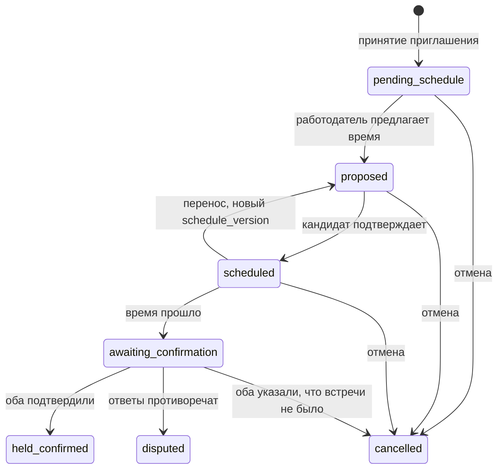

# Signal v2: работа, о которой понятно главное до первого разговора

Дата: 5 октября 2026. Ветка: `codex/signal-product-v2`. Статус: проектное решение для следующей реализации; перечисленные новые функции ещё не созданы. Основание: [ресерч](../../research/PRODUCT_RESEARCH.md), [исходная спецификация и требования ФСП](../../PRODUCT_SPEC.md), [фактический статус](../../implementation-status.md). План исполнения: [signal-v2](../plans/2026-10-05-signal-v2.md).

## 1. Что хотим построить и как принимать решения

Пользователь просит превратить существующий прототип в полезный продукт с сильными сценариями для обеих сторон, измеримым результатом для бизнеса и убедительной защитой на хакатоне. Берём из контекста команду из трёх человек и пять дней; это ограничение планирования, которое следует пересчитать при изменении срока. Полная продуктовая версия шире пятидневного объёма.

Обещание кандидату: «Вы заранее знаете условия, понимаете интерес компании и управляете тем, кто получает ваши контакты». Обещание работодателю: «Вы видите подтверждения по своей задаче, понимаете ограничения поиска и получаете согласованный следующий шаг с человеком».

Основной путь: **предпочтения → понятная роль → доказательства и неизвестное → персональное приглашение → согласие → состоявшийся разговор**. Каждая функция должна улучшать один из этих переходов. Итоговая оценка человека, вероятность найма и обещание трудоустройства не являются продуктовым контрактом.

Для старта: взрослые добровольные участники/выпускники одного доступного ФСП-трека и работодатели, которые действительно нанимают backend/frontend junior/middle. Поддерживаемые четыре категории сохраняются; первый коммерческий пилот выбирает одну категорию по реальному спросу. Доступность этого пула пока не установлена.

## 2. Выбор направления

| Направление | Что даёт | Что ограничивает | Решение |
|---|---|---|---|
| AI-поиск и свайпы вокруг доски вакансий | Быстрый понятный интерфейс | Достоверность ролей, ответ и контакт остаются отдельными проблемами; механика уже распространена | Использовать как способы работы с выбранным сценарием |
| Соревновательный talent marketplace | Хорошая связь с ФСП и оценкой навыков | Личный вклад, рабочая релевантность, доступность кандидатов требуют доказательств | Источник компетенций и разрешённой дистрибуции |
| Взаимно согласованный найм по конкретным задачам и условиям | Обе стороны проверяют существенное до контакта; результат можно измерить | Нужны настоящие роли, дисциплина процесса и ручной пилот | Основное направление v2 |

Анонимность, AI-помощники и доказательства навыков уже есть у [Standout](https://www.ycombinator.com/companies/standout), по заявлениям самой компании. Отдельную уникальность этих функций не заявляем. Наше возможное отличие — привязка к ФСП с индивидуальной атрибуцией, явные условия, диагностируемый взаимный допуск и наблюдаемый путь до встречи. Проверка качества этой связки ещё впереди.

## 3. Что действительно меняется относительно текущего кода

Текущий стек: React/TypeScript/Vite, FastAPI, SQLAlchemy, Alembic, SQLite в локальном demo и PostgreSQL в Compose, SMTP worker. В коде уже есть профиль/PDF, четыре теста, категория, объяснимая выдача, сохранённые поиски, зарплата в приглашении и персональный `ContactGrant`. Демо содержит 48 synthetic profiles; реестр ФСП — mock. Проверки из матрицы реализации описывают предыдущую итерацию, а не проверку v2.

Сейчас кандидат преимущественно ждёт приглашения. Потребность компании не имеет жизненного цикла публичной роли. Причины выбора — строки, итог теста агрегирован; личное доказательство не прикрепляется к отправленному приглашению отдельным контрактом. Процесс заканчивается раскрытием контактов. `public_candidate()` также отдаёт `min_salary_rub` работодателю; v2 делает личный минимум приватным и использует его только для допуска. Этот переход является осознанным изменением продуктовой политики.

`match_v1` сохраняется как историческая версия и comparator. Фиксированный бонус за наличие ФСП и снижение за возраст теста нельзя считать доказанной профессиональной полезностью. V2 отделяет факты происхождения от оценки соответствия; новую формулу допускаем к основному использованию только после сравнения.

## 4. Набор сильных функций и доказательства потребности

| Функция | Боль / основание из ресерча | Поведение | Результат и приоритет |
|---|---|---|---|
| «Мои условия» + помощник ввода | Повторные формы, потеря точных фильтров, нежелательные роли | Человек описывает предпочтения; видит редактируемые условия и явно подтверждает их | Меньше неподходящих предложений; форма H0, текстовый preview H1 |
| Подборка настоящих рабочих задач | Кандидат не хочет ждать в пустом кабинете; неясно, что делать дальше | Небольшой список активных ролей, сохранить/скрыть/выразить интерес без раскрытия контактов | Активный путь кандидата; просмотр/save/hide H0, employer-visible interest H1 |
| «Как будет выглядеть работа» | Неполные описания и расхождение ожиданий | Зарплата, задача первых 30 дней, этапы интервью, тестовая нагрузка, дата подтверждения | Решение кандидата по конкретным условиям; H0 |
| «Почему подходит / что ещё не проверено» | Keyword filtering и самопрезентация плохо передают способности | Каждое утверждение связано с действием и источником; отсутствие доказательства отдельно от негативного результата | Качественный screening и основная защита тестирования; H0 |
| «Что мешает поиску» | Пустая выдача мало помогает работодателю | Контролируемый what-if по бюджету/формату/заявленному стеку на текущем пуле | Проверяемая полезная диагностика и яркое демо; H1 |
| «Разговор под контролем» | Ghosting, длинные паузы, разрыв после интро | Следующий шаг, согласованная встреча, напоминание, подтверждение обеих сторон | Основной продуктовый результат и отчёт работодателю; H1 |
| «Готов обсудить, если…» | Человек может подходить, но один существенный вопрос не прояснён | До контакта — структурированный вопрос по условию, ответ или новая версия условий | Возможная сильная механика после базового пилота; P1 |

H0 — обязательный объём новой хакатонной версии вместе с исходными требованиями. H1 — брать после сквозного H0; порядок отсечения приведён в плане. P1 — следующий продуктовый этап. Это приоритеты, а не заявления о готовности.

Источники предпочтений и боли — смещённые отзывы/опросы, а не точный портрет когорты ФСП. [hh.ru/Dream Job](https://hh.ru/article/kak-soiskateli-vybirayut-rabotodatelej-issledovanie-hh-ru-i-dream-job) подтверждает интерес к свежей информации о работодателе; страницу повторно открыли 05.10.2026, она содержит обновлённое исследование отзывов. Числа старого исследования из ресерча не используем для оценки v2. В [кейсе Notts-Hackers](https://www.nottingham.edu.my/NewsEvents/News/2026/Notts-Hackers-Finish-Second-at-Inaugural-Talentbank-Tech-Hackathon-2026-Competing-Against-Over-1000-Entries-from-27-Countries.aspx) подтверждены второе место, рабочая job platform и приглашение продолжить работу; рыночные результаты там не опубликованы.

## 5. Идеальный путь кандидата

1. Может посмотреть описания ролей до длинного профиля и теста. Импорт резюме/короткий профиль остаётся черновиком. Короткий ввод не должен превращать рассказ о кандидате в поверхностный: система помогает быстро собрать подробное, редактируемое описание достижений — контекст, личный вклад, принятые решения, результат и основание для него — из коротких ответов или уже имеющегося резюме; источники и степень подтверждения видны отдельно.
2. Пишет: «Backend, только удалёнка, от 180 тысяч до налогов, хочу задачи с данными, не готов к многочасовому тестовому». Помощник предлагает поля; зарплата и ограничения видны отдельно. «На руки» нельзя молча переводить в gross: запросить уточнение или ручное значение.
3. Подтверждает жёсткие условия и мягкие предпочтения. Указывает готовность к предложениям; наймовые функции доступны после подтверждения 18+. Самоподтверждение возраста не называется внешней верификацией.
4. До экзамена понимает его назначение и время. Один основной тест на категорию; затем evidence переиспользуется. Кандидат видит конкретные подтверждения и то, что тест не измерял. Без успешно присвоенной категории нельзя отправить employer-visible интерес или попасть в shortlist, как требует исходное ТЗ.
5. Видит до пяти ролей в подборке с зарплатой, задачами, датой актуальности, совпавшими условиями и вопросами. Может открыть ещё пять или все роли через явные фильтры; искусственного ограничения предложения нет. Скрытая роль не возвращается после refresh, решение можно отменить.
6. Выбирает «Мне интересно». Работодатель получает обезличенное доказательство интереса и разрешённую карточку; это не раскрывает контакты и не создаёт приглашение автоматически.
7. Получает приглашение с конкретной зарплатой, причиной выбора, привязанными доказательствами и ближайшим действием. Видит «совпало / неизвестно / противоречит вашим условиям».
8. Явно принимает конкретную версию. До подтверждения видит состав контактных полей и компанию-получателя. Следующий экран — договорённость о разговоре и доступные действия, а не тупик «контакты открыты».
9. Подтверждает предложенное время. После разговора выбирает «Состоялся / не состоялся»; дополнительное качество встречи и причины отказа — необязательные. Может скрыть профиль, заблокировать компанию и отозвать доступ.

Пустые состояния: «нет активных ролей в этом сегменте», «нет подтверждённой категории», «условия несовместимы», «не хватает сведений». Во всех случаях дать конкретный доступный шаг. Не заставлять снижать зарплату, добавлять ФСП или проходить дополнительный тест ради заполнения экрана.

## 6. Идеальный путь работодателя

1. Описывает реальную задачу: «нужно убрать двойную обработку событий». Подтверждает структурированные требования, бюджет, формат, активный headcount и лицо, отвечающее за следующий шаг.
2. Заполняет короткую карточку роли: результат первых 30 дней, этапы интервью, наличие/длительность тестового, response SLA. Черновик может быть неполным; публикация требует конкретных условий.
3. Получает shortlist по подтверждённой категории. В карточке есть релевантное действие, источник/дата, граница доказательства и список неопределённостей. Не превращаем «общая идемпотентность» в «эксперт Kafka».
4. Если людей мало, видит причины потери пула и отдельные сценарии изменения одного требования. Может применить выбранный сценарий; система не меняет условия сама. Counts — про текущую разрешённую базу, не рынок труда.
5. Выбирает доказательство, пишет персональное сообщение и назначает следующий шаг. Зарплата предложения должна целиком помещаться в роль и не нарушать приватный минимум кандидата.
6. После согласия организует разговор и подтверждает его проведение. Видит воронку своей роли, затраты времени и то, на каких этапах люди теряются. Запрашивает следующий платный пилот, когда результат повторяется.

## 7. «Мои условия»: точный контракт

Жёсткие поля H0: минимальная зарплата gross ₽/месяц (может быть не задана), допустимые форматы `remote/hybrid/office`, города для очной работы, исключённые отрасли при наличии данных роли, `max_take_home_minutes` (0 означает отказ от дополнительного company take-home), поиск включён/пауза, блок компаний. Стек/интересующие задачи — мягкие предпочтения; не выводим психологические признаки. Ограничение company take-home не отменяет основной тест категории, о чём сообщаем заранее.

Незаполненное поле роли, нужное для жёсткого условия, даёт `needs_clarification`, а не выдуманное совпадение. Проверенное несовпадение даёт `incompatible`. `compatible` означает выполнение только указанных условий. Технология со статусом «не проверялась» не означает «не знает». Для доказательства требуемой категории действуют отдельные исходные правила.

Помощник возвращает `PreferenceProposal { fields, unresolved, source_spans, parser_mode }`; сохранение отдельное, с `expected_version`. H0 поддерживает формы; H1 добавляет небольшой rules parser русских форматов/зарплаты. Это «помощник», а не фиктивный AI. P1 подключает LLM через тот же контракт после проверки ответов. Текст роли/резюме рассматривается как данные; модель не меняет фильтры, согласие, категорию и решение человека.

`hidden`/`saved` не меняют глобальные предпочтения. После отказа «из-за формата» можно предложить изменение правила; для него нужен отдельный confirm. Никакой скрытой модели, которая решает, что кандидат теперь согласен на меньшую зарплату.

## 8. Карточка роли и неизменяемые условия

Обязательные поля опубликованной H0-роли: название, компания, специализация/грейд, `salary_min_rub > 0`, `salary_max_rub >= min`, валюта RUB/месяц/gross, конкретный формат (не `any`), город для hybrid/office, задача первых 30 дней, `interview_steps` (1–5), `take_home_minutes` (0–240), `response_sla_hours` из 24/48/72, контакт ответственного работодателя, attestation о реальной потребности, `confirmed_at`, статус `active/paused/closed`.

Публикация: employer attestation, не «компания проверена платформой». Роль считается свежей 14 суток после подтверждения — предлагаемый стартовый порог. После срока скрыть из candidate discovery и запретить новые интро; reconfirm обновляет актуальность, но не изменяет условия. API проверяет срок даже при остановленном worker.

Каждая существенная правка создаёт неизменяемый `RoleVersion` и `terms_hash`: зарплата, формат/город, обязанности, этапы/нагрузка и SLA. Новая публикация отменяет непринятые приглашения прежней версии в одной транзакции. Принятый процесс остаётся привязан к прежним условиям; автоматического согласия на новую версию нет. Полноценное предложение изменения уже принятого процесса — P1; в H0 компания сохраняет прежние условия или явно закрывает процесс с уведомлением.

Карточка формулирует факты «работодатель указал/подтвердил», а не гарантирует честность. Статус независимой проверки компании, если появится, отделён от attestation. Свободный текст H0 ограничен 2 000 символами; до раскрытия контактов в нём запрещены внешние персональные ссылки/контакты кандидата. Ответы тестов и именные протоколы ФСП не попадают в публичный DTO.

## 9. Доказательства и тесты: главный защищаемый слой

`EvidenceCard { id, competency, action, source_type, source_id: string|null, source_version, assessed_at, verification_level, scope, limitations, data_mode }`. Внешние достижения, командное место, самоописание и проверенное действие имеют разные статусы. Для team achievement личная роль/артефакт со слов кандидата остаётся `declared`, пока её не проверил разрешённый источник.

Достаточно короткий кандидатский старт — критерий удобства, а не требование сократить смысл: одна и та же карточка должна быстро заполняться и оставаться подробной. H0 использует три обязательных коротких пункта (контекст, личный вклад, результат) и два необязательных (решение, основание); сервер собирает из введённых фактов редактируемый рассказ. Мы не выводим метрики/личный вклад и не повышаем `declared` до `verified`; достижение команды называется результатом команды и не присваивается кандидату целиком. Свободное поле CV и структурированная история хранятся отдельно. История приватна по умолчанию; отдельный явный opt-in разрешает использовать только выбранную EvidenceCard работодателю. Указанный артефакт/ссылка пока тоже остаётся `declared`, пока его не проверил разрешённый источник. В пилоте отдельно замеряются время до первой полезной подборки, время на рассказ, доля пропусков и то, может ли работодатель корректно пересказать вклад кандидата.

Сейчас junior-тест содержит арифметические трассировки, а часть middle — вопросы с выбором ответа. Они позволяют проверить evaluator, но слабо поддерживают широкий hiring claim. Полная v2 развивает рабочие семейства: исправление/различающий тест/изменение условия. Для каждого из 12 семейств нужны явная модель, структурированный ответ, фиксированная рубрика и граница вывода. В пятидневной версии улучшить одно семейство выбранного пилотного трека, проверить его с людьми и честно обозначить узость остальных; полная переработка банка отдельно. Произвольное исполнение чужого кода, proctoring и video emotion analysis не входят в пять дней.

Для H0 доказательство выводится из реально сохранённой завершённой попытки; seed-результат — `synthetic_fixture`, не реальное прохождение. Старым fixtures без item-level результатов нельзя придумывать действие: показать только агрегированный synthetic результат. Для реализованного backend-middle/event-idempotency evaluator фиксирует отдельные верные решения по стабильному ID, конкурентной защите и ответу на повтор; для прочих групп evidence ограничено фактическими вопросами текущего узкого evaluator. Приглашение принимает только `evidence_ids`, принадлежащие адресату и доступные по его настройкам; reason строится из этих фактов. Дополнительное сообщение работодателя визуально отделено от системного подтверждения.

Короткая проверка конкретного пробела — P1: один шаблон на 3–5 минут, только добровольно, без потери категории за отказ; не повторять уже подтверждённое. Она не изменяет основной грейд/score. Полезность такого действия следует проверить на обеих сторонах до обязательного использования.

## 10. Matching, честное неизвестное и симулятор

Порядок: текущая разрешённая видимость → активность роли/кандидата → категория → жёсткие условия → evidence → ранжирование внутри категории → мягкие предпочтения как отдельное объяснение. Новые предпочтения повторно проверяются при отправке и принятии, а не только при поиске. Исторический snapshot не даёт права увидеть скрытый профиль. До подтверждения категории discovery допускает только просмотр ролей с `match_state=not_assessed`; employer-visible интерес не доступен.

`CompatibilityReport { status: compatible|needs_clarification|incompatible, checks: [{ code, status: pass|unknown|fail, public_text }], preference_version, role_version_id, compatibility_version: compat_v2 }`. Кандидату видна его сторона полностью. Работодатель не получает приватный минимум, блок-лист, свободный текст предпочтений и личную причину отказа. Версия compatibility независима от выбранной версии score.

Ответ API на создание приглашения не должен зависеть от того, проходит ли offer личный минимум кандидата: даже generic 409 создаёт машинно-проверяемый salary oracle при серии запросов. После обычных проверок авторизации, видимости, владельца роли и корректности самого offer приглашение создаётся одинаково; приватный CompatibilityReport видит только кандидат. Hard-конфликт блокирует accept до grant, `unknown` остаётся выбором кандидата после явного просмотра, а employer не получает compatibility field или причину отказа. Это закрывает прямой API oracle, не обещая скрыть работодателю осознанное решение самого кандидата.

Для employer search сохраняем требуемое ТЗ поведение: закрытые жёсткие предпочтения участвуют в eligibility до ранжирования, но их значения и индивидуальные причины не возвращаются. Состав выдачи и `unavailable_count` всё же могут стать side-channel при повторении запросов. Этот компромисс принят для текущего продукта; перед поиском по реальным данным нужна отдельная проверка повторных запросов/abuse и решение по ограничению частоты. Это не отменяет фильтрацию и не переносит приватные значения в DTO.

`match_v2` — проверяемый кандидат алгоритма: `60*C + 35*T + 5*N`, где `C` — среднее по выбранным подтверждённым компетенциям, `T` — итог категории /100, `N` — существующее лексическое сходство по подтверждённым компетенциям. Все компоненты в [0,1], результат [0,100]. Отдельного бонуса медали и автоматического штрафа за возраст теста нет. Это выбранная гипотеза, а не оптимальные веса. Дата/источник показываются явно. Несовместимая категория не сравнивается глобальным score; tie-break — `T DESC`, затем стабильный ID.

На одинаковом допущенном пуле сравнить keyword baseline, category+test, `match_v1` и `match_v2`. Новая версия становится основной лишь при отсутствующем нарушении hard constraints и отсутствии ухудшения macro P@5/nDCG@5 на зафиксированной контрольной части. Если evidence недостаточно — показывать честный статус и не объявлять улучшение. Разницу из-за изменения eligibility отдельно от изменения ranking. В v2-банке `BankScore = 100*T`, без общего медального бонуса; даже банк группируется по категориям, несопоставимые тесты не образуют общий лидерборд.

What-if H1 меняет ровно один параметр текущей роли: верхний бюджет (+10/20/30 тысяч ₽, в рамках demo-sценария), формат или обязательный заявленный стек. Вывод: какие ограничения действуют, сколько профилей стало допустимо, что изменилось. Стек, заявленный человеком, всегда подписан; снятие stack-filter не доказывает нужный навык. Симулятор не расширяет согласие, возраст, паузу, блоки или требуемую категорию.

H1-версия симулятора разрешена только на synthetic demo с заметной подписью и без ПДн. Для реального пилота её публичный endpoint выключен до решения по агрегатной приватности. Порог N≥5 сам по себе не предотвращает восстановление приватного минимума через серию запросов; запуск на реальных данных требует фиксированных bucket/ограничения запросов и отдельной проверки.

## 11. Приглашение, контакт и следующий шаг

Сохраняем исходные invitation states `sent/viewed/accepted/rejected/withdrawn/expired` и default expiry 7 суток. Приглашение H0 хранит `role_version_id`, фиксированный `terms_snapshot`, `terms_hash`, `evidence_refs`, совместимость на момент отправки, `response_due_at`. Возможность invitation без публичной вакансии сохраняется: приватная подтверждённая роль подходит, candidate discovery её не показывает.

`response_due_at` — обязательство работодателя после accept: `accepted_at + response_sla_hours`. Оно не сокращает кандидату семидневный срок решения. Первый отмеченный в платформе следующий шаг — предложение времени разговора; отсутствие записи по SLA называется именно отсутствием отмеченного шага, не доказательством отсутствия общения вне платформы. Deadline не меняет consent/invitation state.

Условия приглашения должны быть актуальны и укладываться в подтверждённый бюджет роли; само создание не отклоняется по приватным preferences. Иначе success/error status позволяет перебирать offers и извлекать закрытый минимум. Кандидат видит compatibility разбор (например, диапазон роли 180–250 при личном минимуме 220 может быть совместим для поиска, но конкретное предложение 180–250 конфликтует; 220–250 проходит), employer видит только отправленное предложение. При fail кандидат не может принять до изменения условий; при unknown может явно решить после просмотра или запросить уточнение. Employer-facing API никогда не возвращает compatibility, значение минимума, конкретную проверку или личную причину решения.

Принятие требует актуальные `terms_hash` и `expected_preferences_version`, повторно проверяет адресата, consent, availability, блок компании, активность роли, зарплату/формат/другие hard constraints и срок. В одной транзакции: переход → персональный grant → `HiringConversation` → события. Гонка accept/withdraw имеет одного победителя и `409` у второго; retry возвращает тот же успех. Старые приглашения поддерживаются через явно выделенный legacy path; контакты не добавляются в старые snapshots.

В UI понятное предупреждение: отзыв прекращает дальнейший доступ внутри платформы, но не удаляет уже увиденные компанией сведения. Блок компании отменяет её непринятые приглашения и активные grants кандидата, скрывает профиль от неё. H0 добавляет реальный блок; data export/full erasure обязательны до пилота реальных данных, отдельный релизный критерий.

После accept: `HiringConversation` с pinned условиями и ответственным. Работодатель предлагает время UTC, кандидат подтверждает. По истечении времени обе стороны отдельно подтверждают факт встречи. Она засчитывается только при двух «состоялась» по одной версии времени; разные ответы — `disputed`, молчание — `awaiting_confirmation`, перенос сбрасывает старые подтверждения. Наступление времени само по себе не создаёт метрику.

Нарушение обещанного SLA фиксируется как наблюдаемый факт, а не публичный reputation score. H1 показывает напоминание/доступный следующий шаг. Фактическое качество разговора и совпадение условий — отдельный добровольный вопрос, не обязательное «поставить хороший отзыв».

## 12. UX, который сохраняет управление

Кандидат: «Для меня», «Приглашения и встречи», «Мои доказательства», «Условия и доступ». Работодатель: «Роль и подбор», «Разговоры», «Результаты», «Компания». Для основной роли главные действия видны без длинного просмотра профиля.

Карточка роли: зарплата/формат → задача первых 30 дней → почему совпало → неизвестное → этапы/нагрузка → дата подтверждения → сохранить/скрыть/интерес. Карточка кандидата: релевантное действие → источник → ограничения → остальные факты → приглашение. Итоговый score вторичен; его можно раскрыть с компонентами.

Swipe допустим как альтернативный жест save/hide; кнопки и keyboard-действия всегда остаются. На мобильном нельзя жестом раскрыть контакты или отправить интерес. Дать Undo, не обучать модель на случайном свайпе без confirm. В H0 достаточно хороших карточек, явных действий и состояния; анимация — после устойчивого сценария.

Неформальность — через ясный рабочий язык и реальную задачу команды («что будем чинить», «как принимаем решения»). Она не оправдывает скрытые условия и не превращается в тест личности. Значки «синтетические данные», «со слов работодателя», «проверено этим заданием» точны и читаемы.

## 13. Монетизация: что именно продаём

Первый покупатель — hiring manager/небольшая IT-компания с конкретной финансируемой ролью, готовая рассматривать доступную когорту. Первый товар — **ограниченный sourcing-пилот по одной роли на 14 дней**: нормализация роли, согласованные критерии, вручную проверенная подборка из доступного opt-in пула, персональные приглашения и отчёт до состоявшихся интервью. Не продавать заранее обещанные пять согласий, если подходящего пула нет.

Перед оплатой проверяем feasibility: есть хотя бы пять доступных профильных кандидатов, подходящих по обязательным условиям, и конкретный ответственный работодатель. Это стартовый внутренний gate, не размер рынка. Договор пилота обещает согласованный объём работы/отчёт, а не гарантированный hire. Политика переноса/возврата при невозможности выполнить scope фиксируется перед оплатой человеком; автоматический billing на хакатоне не нужен.

Сценарии чувствительности цены: 15/25/40 тысяч ₽ — гипотезы, не найденная рыночная willingness-to-pay. Для одинакового scope в примере ниже 15 тысяч меньше variable cost17 тысяч, поэтому такой тариф не предлагать без доказанного сокращения затрат. 25/40 тысяч можно проверять коммерческим предложением только после проверки экономики и доступного пула; записывать реальную оплату, отказ и причину. Три клиента не позволяют оценить оптимальную цену статистически.

Пример экономики, все числа предположительные: цена 25 000; sourcing/координация 6 часов × 1 500 = 9 000; технический review 2 часа × 2 000 = 4 000; инфраструктура/LLM ≤1 000; дополнительные acquisition/операционные затраты 3 000. Contribution = 8 000 ₽ (32%). Здесь ещё нет постоянных зарплат/налогов/возвратов и разработки. При 12 часах concierge вместо 6 модель теряет 1 000 ₽ — автоматизация ценна лишь после спроса.

Формулы: `contribution_per_role = revenue - variable_service_cost - variable_infra_cost - attributable_acquisition_cost`; `cost_per_held_interview = attributable_total_cost / held_confirmed_count`; `revenue_per_held_interview = role_revenue / held_confirmed_count` — аналитика, не обещание/тариф. При нуле интервью ratio не определён; выводить абсолютные расходы и 0 результата.

После повторных оплаченных ролей: подписка компании за активные роли/координацию/аналитику; дополнительно sponsor-funded skill challenge для конкретной рабочей потребности с добровольным участием. Success fee возможен после проверки атрибуции и длинного цикла денег; это отдельный договор. Кандидату бесплатно: профиль, категория/базовый assessment, поиск, видимость, согласие и удаление. Платные boosts, продажа ПДн и pay-to-apply исключены.

Партнёрский ФСП/вузовский канал — гипотеза разрешённого distribution, не уже заключённое партнёрство. [Ретроспектива Triplebyte](https://www.otherbranch.com/shared/blog/why-triplebyte-failed) показывает риск несоответствия привлечённого пула ожиданиям платящих компаний; это рассказ бывшего руководителя, не независимый аудит. Поэтому пул и роль подбираем совместно до широкой автоматизации.

## 14. Метрики и решения пилота

North star: **взаимно подтверждённые состоявшиеся первые интервью по совместимым условиям на 100 активных opt-in кандидатов за 30 дней**. Активный кандидат — 18+, подтверждённая категория, опубликованный профиль, availability подтверждена за последние 30 суток, поиск не на паузе. В числителе — одна первая встреча на уникальную пару «роль—кандидат», pinned версия условий, обе стороны подтвердили проведение. Демо/fixtures исключены.

Отдельный коммерческий результат: повторная оплаченная роль от того же работодателя и contribution. Это сильнее регистрации/клика, но не равно PMF при маленькой выборке.

| Этап | Метрика с знаменателем | Что решаем |
|---|---|---|
| Feasibility | Роли с ≥5 доступными совместимыми кандидатами / роли пилота | Есть ли товар, который можно продавать |
| Discovery | Люди с одним сохранением/интересом / люди, увидевшие ≥1 подходящую роль | Помогает ли кандидатский вход |
| Invitation | Уникальные accepted / уникальные sent, по pinned роли | Полезны ли условия и объяснение |
| Next step | Conversation с подтверждённым временем / accepted | Закрываем ли разрыв после контакта |
| Outcome | held_confirmed / accepted; held_confirmed / scheduled | Где теряется реальная встреча |
| Процесс | Нарушенные response due / процессы с наступившим due | Выполняет ли компания обещанный шаг |
| Качество | Противоречие существенных условий / добровольные ответы после встречи | Есть ли скрытые несоответствия |
| Бизнес | Вторые оплаты / работодатели, завершившие первый пилот | Есть ли повторная потребность |

Guardrails: время onboarding/assessment, число нежелательных интро, отмены consent, незаполненные обязательные условия, stale роли, no-show/disputed, запросы удаления, различия по четырём категориям и группам с/без ФСП. Возраст/пол/лицо/вуз не входят в ранжирование.

Пилот: 20–50 взрослых добровольцев и 3–5 компаний в одной категории; размеры — предлагаемый дизайн. Сначала качественные наблюдения и абсолютные события. Условные стартовые критерии продолжения: ≥3 оплаченных role pilots, ≥2 повторные оплаты/подписанные вторые роли, положительный contribution после фактической стоимости concierge. Если работодателям не нужен доступный пул, меняем сегмент/канал; если им нужны люди, но условия не сходятся, работаем с ролью; если accept есть, но meetings нет — исправляем координацию. Дополнительные AI-фичи не заменяют этот диагноз.

## 15. Границы пяти дней и развитие

H0: исходные обязательные функции, preferences с confirm, короткая candidate discovery через опубликованные роли, конкретная role card/version, evidence-linked приглашение, совместимость при send/accept. H1: synthetic what-if, план встречи/двойное подтверждение и минимальный metrics report. Время на тесты навыков, независимую оценку ranking, деплой и демонстрацию защищено от feature sprawl.

Следующий этап P1 (после демонстрации основного пути): настоящий LLM-помощник через тот же preview/confirm; «Готов, если…» с ограниченными вопросами и review новой версии; один добровольный gap microtask; экспорт employer brief; granular consent, удаление/retention, проверка компании и адаптер ФСП при разрешённом источнике. Public real-data запуск требует своего release gate, даже если demo готово.

P2 при повторном спросе: ATS-интеграция с одним подтверждённым каналом; платные планы, доказанные cohort economics, 30/90-дневный opt-in pulse «обещано/произошло», расширение тестов и категорий. Public feed, чёрные списки, лидерборд людей, автоматические отказы/отклики, personality scoring и платная видимость в roadmap не включены.

## 16. Архитектура и границы модулей

Сохраняем модульный монолит и текущие зависимости. Нет причины добавлять микросервисы, vector DB, Kafka или отдельный orchestration framework на этот объём. AI-adapter в P1 — optional preview, а не critical path matching или согласия.

| Файл / модуль реализации | Ответственность и контракт |
|---|---|
| `backend/preferences.py` (новый) | `propose_preferences(text)`, подтверждение версии, блок/пауза, нормализация legacy полей |
| `backend/role_cards.py` (новый) | RoleVersion, publish/reconfirm/revise, candidate decisions/discovery; только разрешённые роли |
| `backend/evidence.py` (новый) | EvidenceCard из завершённой попытки/fixture; проверка ownership/видимости, без ключей/ответов |
| `backend/matching.py` (расширить) | `evaluate_compatibility(..., mode)`, структурированные причины, версии scoring, synthetic what-if |
| `backend/invitations.py` (новый) | Перенос существующих переходов в единый service: идемпотентность, CAS, pinned условия и grants |
| `backend/conversations.py` (новый, H1) | Предложение/подтверждение времени, перенос, факт встречи, version/CAS |
| `backend/product_events.py` (новый) | Запись whitelist-событий и расчёт employer funnel; бизнес-сервисы не делают собственный commit |
| `backend/routes_v2.py` (новый) | Тонкий APIRouter для additions; использует существующие `get_user`, `require`, `csrf_guard`, `get_db` |
| `backend/main.py` | Существующие маршруты остаются; новые подключаются router, invitation routes вызывают service |
| `backend/models.py`, `schemas.py` | ORM/constraints и типизированные DTO; доменные алгоритмы туда не помещаются |
| `frontend/src/api.ts`, `types.ts` (новые) | Извлечённые API helper/DTO, повтор запроса с сохранённым idempotency key, AbortSignal |
| `frontend/src/features/preferences/`, `roles/`, `evidence/`, `conversations/`, `metrics/` | Небольшие компоненты новых сценариев; текущий App подключает вкладки, без полной переписи |

Новые маршруты имеют `response_model` и allowlist. В пятидневной версии company scope — существующий `EmployerProfile.user_id`; несколько рекрутеров в организации — отдельная модель P2. Новых runtime dependencies не требуется; для автоматического browser flow допускается один dev-инструмент Playwright с фиксацией версии/lock.

## 17. Данные и миграции

| Объект | Добавления / назначение |
|---|---|
| `User` | `origin` = direct_signup/synthetic_fixture/legacy_import; происхождение, не проверка подлинности личности |
| `CandidateProfile` | `preferences` JSON, `preferences_version ≥1`, `preferences_confirmed_at`, `adult_attested_at`, `blocked_employer_ids` JSON, nullable `verified_attempt_id` FK, private `achievement_story` JSON (candidate-entered fields + explicit share flag; never employer-public as part of profile DTO) |
| `HiringNeed` | `current_role_version` integer≥0 (0=ещё нет версии), `publication_state` = draft/active/paused/closed, `discoverable` bool default false, `confirmed_at`; текущие поля — проекция версии для legacy API |
| `RoleVersion` (новая таблица) | id, need_id, version, schema_version, payload JSON, terms_hash, source = employer_declared/legacy_import/synthetic_demo, created_at; unique need+version |
| `RoleDecision` (новая) | candidate_id, need_id, role_version_id, action = saved/hidden/interested/none, preferences_version, updated_at; unique candidate+need; none отменяет выбор |
| `SearchSnapshot` | Nullable role_version_id; сохранённые входы оценки/причины/источник, версия prefs и дата; без контактов и приватного salary floor |
| `Invitation` | Nullable role_version_id для старых, terms_snapshot/hash, explanation_snapshot, state_version ≥1, response_due_at; old reason как отдельный employer comment |
| `ContactGrant` | Существующий invitation FK и уникальность; не создаём заменяющую таблицу доступа |
| `HiringConversation` (новая, H1) | id, unique invitation_id, state, state_version, schedule_version, proposed_start_at/scheduled_at/ends_at UTC, proposer, timezone, confirmations JSON по actor и schedule version, updated_at |
| `ProductEvent` (новая) | UUID, type, entity_type/id, employer_id scope, nullable actor_id, occurred_at UTC, data_mode, whitelist payload, unique dedupe_key |

`CandidateProfile.min_salary_rub` сохраняет существующий legacy sentinel 0 для «не задано»; новый DTO возвращает null. `work_format` — legacy projection: один допустимый формат или `any` при нескольких; новый matcher использует полный набор из preferences. Старый profile PUT при изменении этих полей обновляет соответствующие preferences и единую версию. Блок-лист изменяется отдельной командой, не свободным payload.

Текущую RoleVersion выбираем по unique `(need_id, version)` и counter HiringNeed; обратный FK из need в child не добавляем, чтобы не создавать циклическую миграцию. Новая версия и CAS counter/projection записываются атомарно. Search/Invitation ссылаются FK на конкретный RoleVersion.id. Начальное редактирование передаёт expected_version=0.

Отдельная EvidenceItem-таблица для H0 не нужна: id assessment-доказательства детерминирован из attempt ID и компетенции, source_version содержит blueprint/evaluator. Кандидатский рассказ хранится в одном приватном JSON поле профиля, а не копируется в публичные candidate/search DTO; employer projection включает его только по отдельному share opt-in и через выбранный EvidenceCard. При future внешних источниках можно материализовать evidence в отдельной таблице. `verified_attempt_id` устанавливается только успешным submit; старым профилям ссылка восстанавливается лишь при однозначно подтверждаемой связи, fixtures без попыток остаются null.

SearchSnapshot хранит whitelist исходных assessment/competency values и explanation для воспроизводимости score. На чтении повторно проверяются current consent/availability/block и выдаётся `changed_since_search`. Входы private eligibility не превращаются в публичный DTO; полный исторический профиль не сохраняем. Актуальный поиск требует нового snapshot. Parent допустим только при том же владельце, need и role version; изменение роли начинает новую цепочку.

Миграции после `41dbe7c98854`: A — role/preferences/decision/event schema и nullable связи; B — invitation constraints/state-version; C — optional conversations. Использовать Alembic на пустой PostgreSQL и upgrade копии текущей БД. Legacy роли получают только реально существующие поля и статус draft/legacy; старым приглашениям нельзя приписывать текущую версию роли задним числом.

Перед partial unique index одного sent/viewed приглашения на employer+candidate: legitimately expired строки переводятся в expired; настоящие активные дубликаты вызывают диагностическую остановку миграции. Не удалять записи и не выбирать победителя произвольно. Явный migration report и решение владельца данных нужны только при обнаружении реального конфликта.

## 18. API для реализации

Все paths ниже имеют префикс `/api/v1`. Чужой объект — 404; неправильная роль — 403. Изменения защищены текущим CSRF/origin guard. Заявленные signatures/paths — решение v2, а не уже существующие endpoints.

| Метод / путь | Основной контракт |
|---|---|
| GET/PUT `/candidate/preferences` | Payload + version; PUT expected_version, подтверждённые hard/soft поля |
| POST `/candidate/preferences/preview` (H1) | Текст ≤2 000 → proposal/unresolved/parser_mode; никаких записей |
| POST `/candidate/companies/{employer_id}/block` | Идемпотентно закрыть discoverability, pending invitations и все grants пары |
| POST `/candidate/companies/{employer_id}/revoke-contact` | Закрыть все grants пары; old single-grant revoke сохраняется |
| GET `/candidate/evidence` | Разрешённые собственные EvidenceCard, без answer_key |
| GET `/candidate/roles` | Cursor/limit 5, актуальные published roles; compatible и отдельный needs_clarification; скрытые исключены |
| PUT `/candidate/role-decisions/{need_id}` | action + expected_role_version + expected_preferences_version; H0 saved/hidden/none(Undo), H1 interested требует категорию, opt-in и compatible |
| GET `/employer/needs/{need_id}/interests` (H1) | Только владелец; текущая доступность/блок проверяются, личных контактов нет |
| GET `/employer/needs/{need_id}/role-card` | Draft или текущая версия + history metadata |
| POST `/employer/needs/{need_id}/versions` | expected_version + готовая карточка → новая immutable версия, projection/CAS и withdrawal stale pending |
| POST `/employer/needs/{need_id}/publish` | Готовые конкретные поля, attestation, discoverable bool → active/confirmed_at; false оставляет подтверждённую роль приватной |
| POST `/employer/needs/{need_id}/reconfirm` | expected_version, attestation; условия неизменны |
| POST `/employer/needs/{need_id}/pause` | Запрет новых действий; pending приглашения прекращаются, accepted процесс остаётся pinned |
| POST `/employer/searches/preview` (H1) | synthetic-only role_version+single change → reasons/count; no side effects |
| POST `/employer/invitations` (расширенный) | Текущий Idempotency-Key, role version или inline role card, evidence_ids, actual offer terms |
| POST `/invitations/{id}/accept` (расширенный) | expected_terms_hash + expected_preferences_version для v2; повторно проверяем актуальные ограничения |
| GET `/candidate/conversations`, `/employer/conversations` (H1) | Только участник/свой employer; pinned условия и разрешённая timeline |
| POST `/conversations/{id}/propose-time` | expected_version, starts_at UTC, duration_minutes 1–240, IANA timezone; employer предлагает время в будущем |
| POST `/conversations/{id}/confirm-time` | expected_version + schedule_version; candidate подтверждает |
| POST `/conversations/{id}/confirm-held` | expected_version + schedule_version + held bool; после времени, участник отдельно |
| POST `/conversations/{id}/cancel` | expected_version; любой участник, фиксированная необязательная taxonomy-причина |
| GET `/employer/metrics` (H1) | from/to, role filter; собственная cohort-воронка и data_mode=real по умолчанию |

Ошибки: `PREFERENCES_VERSION_CONFLICT`, `ROLE_VERSION_CONFLICT`, `ROLE_STALE`, `ROLE_INCOMPLETE`, `CONDITIONS_INCOMPATIBLE`, `CONDITIONS_UNKNOWN`, `EVIDENCE_NOT_AVAILABLE`, `COMPANY_BLOCKED`, `CONVERSATION_STATE_CONFLICT` — 409; неверные field значения — 422. Не включать скрытые значения кандидата в detail. Inline card сохраняет invitation without vacancy/need: проходит те же проверки и получает собственный immutable snapshot.

## 19. Переходы, транзакции и события

Все invitation переходы (view/reject/withdraw/expire/accept) используют conditional SQL update по текущему state/version и времени. Состояние, grant, conversation и `ProductEvent` фиксируются одним commit. Worker использует тот же переход и dedupe. SQLite не заменяет concurrency proof PostgreSQL; включить FK pragma для SQLite-тестов.

Подтверждать проведение можно после `ends_at`, не сразу после начала. Если одна сторона ответила «нет», а другой ответ пока отсутствует, state остаётся awaiting_confirmation с видимым участникам фактом. Disputed — yes/no; два no — cancelled. Старое schedule подтверждение после переноса отклоняется. `held_confirmed`/`cancelled` терминальны для версии встречи; исправление спорной записи — ручной разбор, не создание ещё одного outcome. Legacy accepted invitation можно импортировать pending_schedule с текущей датой и `legacy_imported`; прошлую встречу не выдумывать.

Ключ события задаётся domain operation: invitation_id+transition version, conversation_id+schedule version+actor+confirmation; одинаковый HTTP retry не повышает воронку. События: `role_published`, `role_reconfirmed`, `preferences_confirmed`, `role_interest_sent`, `invitation_sent`, `invitation_accepted`, `invitation_rejected`, `invitation_withdrawn`, `contact_access_revoked`, `interview_time_proposed`, `interview_scheduled`, `interview_confirmation_submitted`, `interview_held_confirmed`, `interview_disputed`, `process_deadline_missed`. Client pageviews отдельно и не являются результатом найма.

Data mode определяется сервером: APP_MODE demo/test → synthetic_demo; в live любой synthetic actor/profile/role → synthetic_demo; импорт legacy → unknown; прочие direct-signup события → real. Это provenance, не подтверждение подлинности пользователя. Старые User получают legacy_import, seed — synthetic_fixture, новые регистрации — direct_signup. Demo события доступны в явно переключённом режиме, не входят в реальную выручку/конверсии. В event payload нет текста резюме, контактов, salary floor, ответов теста и свободной причины отказа.

MailOutbox — доставка уведомлений, не source of truth доменных событий. SMTP-сбой не откатывает состоявшееся согласие; retry не создаёт второй invite/event. Один worker в H0; horizontal delivery требует lease/claim и проверку повторов P1. Сроки роли/приглашения/SLA вычисляются сервером независимо от worker.

## 20. Проверка результата и готовность

Функциональная готовность: hard constraints не обойдены ни через старый snapshot, ни при изменении preferences, ни при retry; данные/источник честно обозначены; invitation snapshot неизменяем; чужой employer не получает контакт; block/revoke прекращает весь доступ пары; accepted не равен held. Пять пользовательских проходов без подсказок показывают, понимают ли люди условия и последствия действий.

Для ranking предложенный расширенный план — 8 role queries (по 2 на категорию), полные доступные пулы по 12 demo-кандидатов = 96 пар. Два оценщика независимо размечают 0–3 по исходной рубрике, без итогового score/позиции/FSP-медали. Если реальная добровольная выборка доступна — отдельный dataset и отчёт; синтетика всегда отдельно. Половина queries dev, половина holdout; семьи задач и role тексты не настраиваются по holdout после раскрытия меток. При нехватке времени минимум исходной спецификации 40–60 пар; показать неполную разметку и оценивать только полностью размеченные query pools.

P@5 = relevant labels 2/3 в топ-5 /5, короткая выдача не повышает знаменатель. nDCG@5 по grades 0–3, gain `2^grade - 1`; IDCG вычисляется только из полного размеченного пула. Queries без релевантных показываются отдельно. Таблица win/tie/loss по queries и категориям, raw labels, disagreement и sample size обязательны. Small-N не доказывает качество найма; итоговые результаты пока отсутствуют.

Для выбранного улучшенного assessment family: 100 seeds, эталон/контрпример/мутация/ошибки, отсутствие ключей в DTO, прежние правила 20 минут /70 points /50% группы /correct mutation /72 часа /30 дней /3 за7 дней. Пилот 6–12 добровольцев с вариантами A/B и чередованием порядка — цель, не имеющаяся выборка; если не успели, пишем «калибровка не проведена».

Технический release gate demo: Alembic с нуля и upgrade legacy на PostgreSQL, реальные tests race/create/accept/revoke, Origin/CSRF с одним PUBLIC_BASE_URL, Mailpit, Linux PDF, frontend build, browser flow обеих ролей, seed повторяемый и ярлыки demo, fallback видео. При отсутствии Docker/стенда конкретную проверку пометить not verified, не заменять config check успешным deploy.

Release gate real pilot: законный разрешённый источник и opt-in 18+, версия consent, self-service export/delete/retention, проверка компании, реальные согласованные роли, synthetic отключён в live search, isolation/секреты/HTTPS/бэкапы, журнал доступа и обработка жалоб. Это отдельный этап, его нельзя автоматически считать выполненным вслед за хакатонным demo.

## 21. Что показать жюри

Три различимых демонстрационных момента: (1) работодателю объясняем, какие требования ограничили его разрешённый пул; изменение одного параметра меняет реальную выдачу; (2) карточка показывает проверенное действие и переводит неизвестное в понятный вопрос первого разговора; (3) изменение предпочтений/условий блокирует устаревшее принятие, пока человек не увидит актуальную версию. После успешного согласия есть измеряемый следующий шаг.

H0 строит короткую повестку первого разговора из `unknown`/`gap`: «Нагрузку production не оценивали — обсудить пример такой работы». Это шаблон по ограничениям EvidenceCard, без нового AI/экзамена. Храним её в explanation_snapshot; обе стороны видят одинаковую повестку. Польза проверяется пониманием и неожиданными блокерами на разговоре.

Показ 5–6 минут: 0:00–0:35 проблема и сегмент; 0:35–1:20 кандидат/предпочтения и настоящее прохождение части задания; 1:20–2:15 задача работодателя, evidence и неизвестное; 2:15–2:50 what-if если готов; 2:50–4:00 приглашение/изменение условий/явное согласие и второй employer без доступа; 4:00–4:35 план встречи/двойное подтверждение если готов; 4:35–5:20 реально полученные метрики/границы; 5:20–6:00 покупатель, товар пилота и следующий эксперимент.

В исходном ФСП ТЗ подбор 35%, тесты/валидация 25%, UX 10%, tech 7%, docs/completeness 6%, extras 7%, presentation 10%. Блоки доказательства/assessment/ranking занимают приоритет и дают 60% rubric. Tradeoff simulator/карточки/AI не вытесняют измерения. Данные/встречи из ускоренного demo явно synthetic; приглашение Talentbank сотрудничать или наш концепт тарифа не выдаются за платных клиентов.

## 22. Пятидневное исполнение и решения остановки

Рабочий cap — 105 человеко-часов (3 ×5 ×7 продуктивных часов). Технический sidecar оценил новую роль/preferences/atomic invitations/одну встречу уже на весь этот объём; поэтому H1 и full-bank enhancement не обещаем одновременно. Распределение: база/миграции/гонки 20ч; preferences+role card+evidence+compatibility 28ч; candidate discovery 8ч; одна улучшенная assessment family+разметка/UX 24ч; стенд/упаковка/демо 17ч; резерв 8ч. Это предварительные бюджеты, не измеренная скорость команды.

Если экономим объём: rules parser заменяется формой; candidate discovery остаётся простым read-only списком с save/hide, interest переносится; one-family enhancement требует evaluator/review, иначе показываем текущий с честным ограничением; what-if и conversation metrics показываются как отдельный концепт/ручной пилот, а не имитация endpoints. Нельзя сокращать защиту контактов, версии условий, исходные обязательные функции и честность оценки.

День 1: зафиксировать DTO/схемы и поднять рабочую миграцию PostgreSQL; другой участник готовит evidence/рубрику и внешний review; UI строит карточки на тех же DTO. День 2: end-to-end role→search→evidence-linked invitation→accept с актуальными constraints. День 3: candidate discovery и выбранный H1 только при зелёном core; разметка/UX идут параллельно. День 4: валидировать, исправить, заморозить feature scope; день 5: сборка, Linux/PDF/почта, документация и репетиции, исправлять только blockers.

До конца дня 2 нет сквозного сценария — все H1 снимаются. До середины дня 4 нет разметки — не объявлять улучшение ranking; держать comparison-ready данные и честный результат. Нет paid demand после десяти конкретных предложений подходящим работодателям — не расширять автоматизацию, сначала пересмотреть товар/сегмент. Нет совместимого opt-in supply — не продавать обещания заполнить роль.

## 23. Что создаёт долгосрочное преимущество

Разрешённый доступ к конкретной когорте; качественные рабочие семейства и provenance индивидуального вклада; процесс, который компании действительно повторяют; добровольные данные о совпадении обещаний с реальностью. Эти элементы требуют времени и договорённостей. Красивый чат, тип карточки и сама формула воспроизводимы конкурентом; «никто никогда не думал» не используем в защите.

Проверяемая сильная гипотеза: связывание **«доказано / неизвестно / конкретное условие / следующее действие»** в одной транзакции уменьшит пустые разговоры и даст работодателю экономию времени. Зарабатывать можно, когда эта экономия и доступный пул подтверждаются оплаченной повторной потребностью.

Технические первичные справочники для реализации: [SQLAlchemy: SQLite FK](https://docs.sqlalchemy.org/en/20/dialects/sqlite.html#foreign-key-support), [PostgreSQL: partial indexes](https://www.postgresql.org/docs/current/indexes-partial.html), [Playwright: test web server](https://playwright.dev/docs/test-webserver). Они не являются отчётом о проверке текущего стенда.
